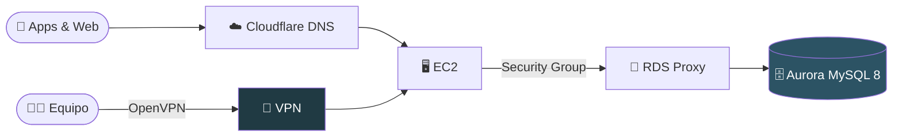

<!-- ══════════════════════════ CABECERA ══════════════════════════ -->
<p align="center">
  
</p>

<p align="center">
  <a href="https://adriacasas.es">
    
  </a>
</p>

<p align="center">
  <a href="https://adriacasas.es"></a>
  <a href="https://www.linkedin.com/in/casasadria"></a>
  <a href="https://instagram.com/casas_adria"></a>
  <a href="mailto:adriacasas48@gmail.com"></a>
  
</p>

<!-- ══════════════════════════ WHOAMI ══════════════════════════ -->

```bash
adria@banyoles:~$ whoami
```

```yaml
nombre:      Adrià Casas Llorens
rol:         Full-Stack Web & Mobile Developer
empresa:     ID·Waste  # casi 2 años · software para gestión de residuos y limpieza viaria
ubicacion:   Banyoles, Girona 📍
formacion:   [DAM, SMX]
filosofia:   "La seguridad no es un paso final, es parte de cómo construyo."
ahora_mismo: 
  - Desarrollando W·Route, W·Task, W·Link, W·Data, W·City e ID·Soft
  - Cerrando redes: de accesos abiertos a IP + VPN
  - Exprimiendo índices en MySQL 8 en producción
fun_fact:    Hice una app Android entera porque perdía el mando del ventilador 🌀
```

<!-- ══════════════════════════ STACK ══════════════════════════ -->

## 🛠️ Stack

<p align="center">
  <br/>
  <br/>
  
</p>

<!-- ══════════════════════════ ID·WASTE ══════════════════════════ -->

## 💼 Qué hago en ID·Waste

<table>
<tr>
<td width="50%" valign="top">

### 🧩 Producto
- Plataforma completa: **W·Route, W·Task, W·Link, W·Data, W·City, ID·Soft**
- **Web:** PHP + JavaScript sobre framework propio
- **Android:** Kotlin · **iOS:** Swift
- Integraciones con sistemas de empresas externas

</td>
<td width="50%" valign="top">

### 🏗️ Infraestructura
- **AWS:** EC2, RDS Aurora / MySQL 8, RDS Proxy
- Grupos de seguridad, **OpenVPN**, DNS en **Cloudflare**
- Migración de accesos abiertos a red restringida por IP + VPN
- Esquemas, queries e índices en producción real

</td>
</tr>
</table>

<details>
<summary><b>🗺️ Ver cómo pienso una arquitectura</b> (clic para desplegar)</summary>
<br/>



Solo se habla quien tiene que hablarse. Todo lo demás, cerrado.

</details>

<!-- ══════════════════════════ PROYECTOS ══════════════════════════ -->

## 🚀 Proyectos personales

<table>
<tr>
<td width="50%" valign="top">

### 📡 IRBlast
Mando IR universal para Android. Emisor IR del móvil **o** un ESP32 por WiFi que captura las señales del mando original.

`Kotlin` `MVVM` `Room` `StateFlow` `Material 3` `ESP32`

> 19/19 botones configurados. Mando físico en el cajón para siempre.

</td>
<td width="50%" valign="top">

### 🌍 [adriacasas.es](https://adriacasas.es)
Portfolio rehecho desde cero con API REST propia, MySQL y tres idiomas (CA · ES · EN). Desplegado con Docker + Cloudflare Tunnel.

`PHP` `MySQL` `JavaScript` `Docker`

</td>
</tr>
<tr>
<td width="50%" valign="top">

### 🍓 Homelab
Raspberry Pi 24/7 sustituyendo un servidor dedicado: portfolio, Plex, nube privada y Pi-hole. Sin abrir puertos en el router.

`Linux` `UFW` `OpenVPN` `Cloudflared` `Pi-hole`

</td>
<td width="50%" valign="top">

### 🏆 [LearnTrack](https://www.learntrack.cat)
Ganador del **premio Jordi Pujiula** (PEHOC) en Ciencias Aplicadas y Tecnología.

`Premio` `Proyecto en equipo`

</td>
</tr>
</table>

<!-- ══════════════════════════ SNAKE ══════════════════════════ -->

## 🐍 Mis contribuciones

<p align="center">
  <picture>
    <source media="(prefers-color-scheme: dark)" srcset="https://raw.githubusercontent.com/casasadria/casasadria/output/github-snake-dark.svg" />
    
  </picture>
</p>

<!-- ══════════════════════════ PIE ══════════════════════════ -->

<p align="center">
  
</p>
